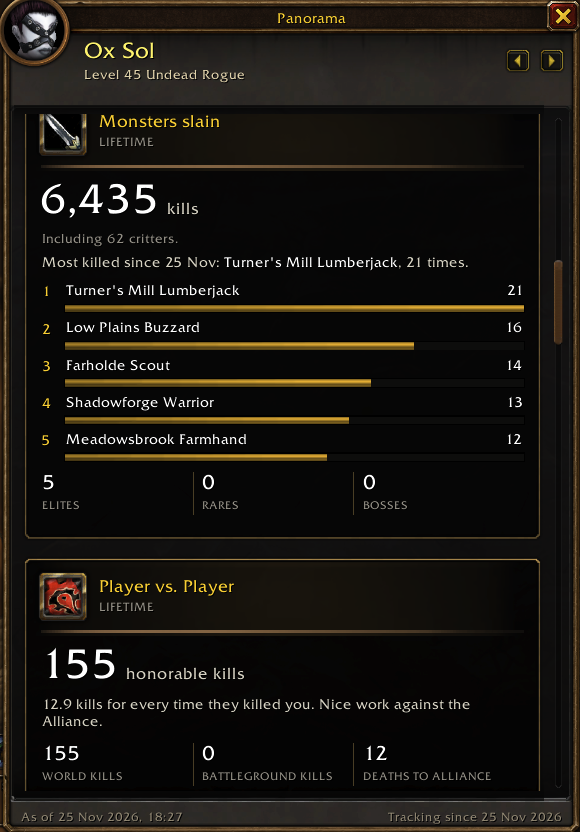

# Panorama

Panorama shows stats and highlights from your character's adventures in WoW Forever, as a scrollable set of
cards you open from the minimap.

## What it shows

- Time played, your favourite zone, and how far you've travelled
- Kills, deaths, gold earned and the best loot you've found
- Your signature spell, the dungeons you've run and the companions you've had
- When you like to play, the milestones you've reached, and your professions and reputations
- A play style based on what you do most

## How it works

A few numbers come straight from the game: time played, completed quests, honorable kills, gold, professions
and reputations. Everything else is counted by Panorama from the moment you install it, separately for each
character. Cards fill in as you play.

## Commands

| Command | What it does |
|---|---|
| `/panorama` or `/pano` | Open or close your journey |
| `/pano minimap` | Show or hide the minimap button |
| `/pano stats` | List the game statistics Panorama reads |
| `/pano reset` | Wipe what Panorama tracked for this character (asks to confirm) |

## License

MIT. See [LICENSE](LICENSE).
